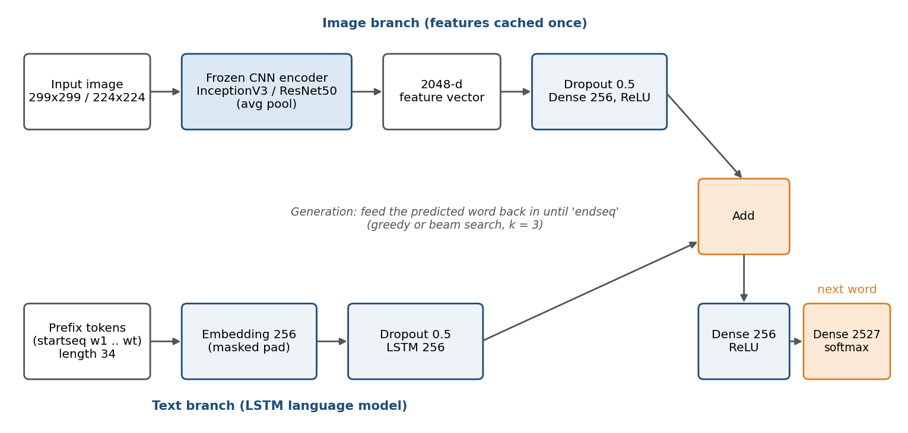
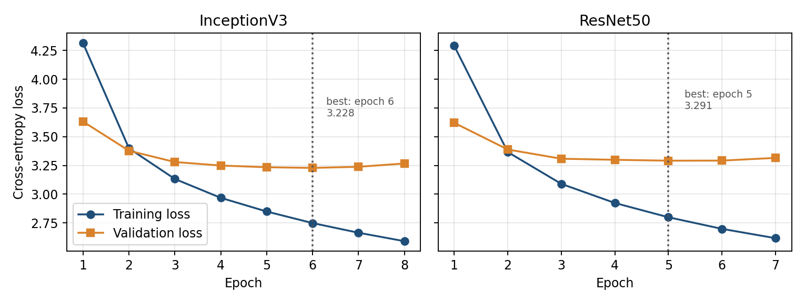
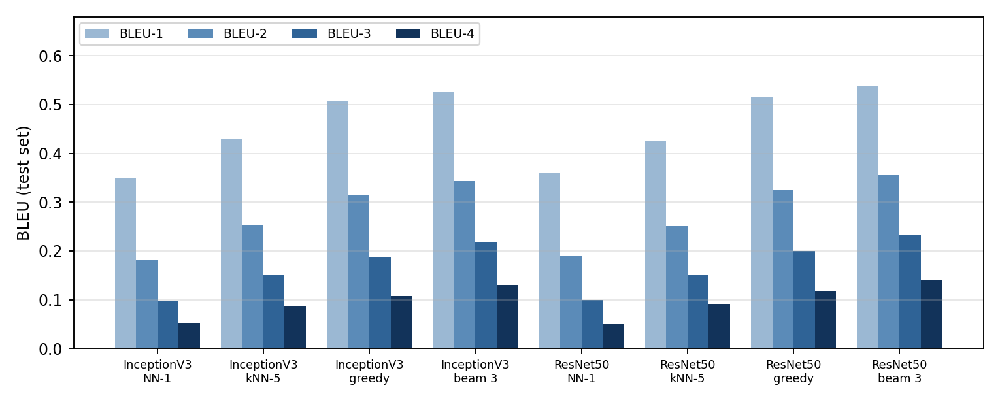

# Image Captioning on Flickr8k: CNN encoder + LSTM decoder

| Field | Details |
|---|---|
| Name | Sanskriti Parakh |
| Registration number | 23FE10ITE00298 |
| Course | Deep Learning – Case Study |
| Assigned case study | Case Study 9: Image Caption Generation (CNN + LSTM encoder–decoder, Flickr8k) |
| Section | B |
| Programme | B.Tech CSE |
| Department | Information Technology |
| University | Manipal University Jaipur |
| Live demo | https://flickr8k-captioning-jp9tfcuw88xxt5vjxsgykw.streamlit.app/ |
| Source code | https://github.com/sanskriti25-95/flickr8k-captioning |

## 1. Problem Statement
Image captioning is the task of generating a short natural-language description of a photograph. It combines computer vision (understanding what is in the image) with language modelling (producing a fluent sentence). This case study builds a captioning system for the Flickr8k dataset using the classic encoder–decoder design: a pretrained convolutional neural network (CNN) encodes the image, and a recurrent LSTM network decodes that encoding into a caption one word at a time.

The goals are to (1) train a CNN + LSTM captioner, (2) compare two CNN encoders (InceptionV3 and ResNet50), (3) compare greedy decoding with beam search, (4) measure all of this against a simple retrieval baseline that writes nothing new, and (5) report scores with the BLEU metric on the official test split so they can be compared with published work. The best model is **ResNet50 with beam search**: BLEU-1/2/3/4 = **0.538 / 0.357 / 0.232 / 0.141**.

## 2. Dataset Description
- **Source:** the assignment points to the Kaggle copy of Flickr8k (kaggle.com/datasets/adityajn105/flickr8k). Instead we downloaded the original **official Flickr8k release** (`Flickr8k_Dataset.zip` and `Flickr8k_text.zip` from github.com/jbrownlee/Datasets), because it includes the official split files. The Kaggle copy would only have been needed as a fallback.
- **Content:** colour photographs of everyday scenes, mostly people and dogs doing activities outdoors. Each image has **5 human-written captions**, stored in `Flickr8k.token.txt`. The release contains slightly more than 8,000 images (8,092 have captions listed), but only the **8,000 images named in the official split files** are used, with their 40,000 captions.
- **Split:** the **official split** from `Flickr_8k.trainImages.txt`, `Flickr_8k.devImages.txt` and `Flickr_8k.testImages.txt`: **6,000 train / 1,000 dev / 1,000 test** images. Using the official split keeps results comparable with published work. The dev set is used only for early stopping; the test set is used only for the final scores.
- **Characteristics:** captions are short (about 9.2 words on average after cleaning) and use a small vocabulary. In the training captions "dog(s)" appears in about 24% and "man" in about 17%, against only about 8% for "woman". There are almost no close-up portraits or selfies, which limits how well the model generalises to other kinds of photos.

## 3. Data Preprocessing
**Captions**
- Lowercase, keep letters only, drop one-character tokens, and wrap each caption in `startseq … endseq`.
- Build the vocabulary from the training captions only, keeping words seen at least 5 times. This gives **2,527 tokens**, including `<pad>`, `<unk>`, `startseq` and `endseq`. The longest prefix is 34 tokens.
- Each caption is expanded into progressive training pairs (image, words so far) → next word. This gives **307,078 training pairs** and 51,733 dev pairs, built into arrays up front.

**Images**
- Images are resized to the encoder's input size (299×299 for InceptionV3, 224×224 for ResNet50) and normalised with that network's own `preprocess_input`.
- Because the encoder is frozen, the 2,048-number feature vector for every image is computed **once** and cached (`outputs/features_*.npz`). Training then only reads the cached vectors.

## 4. Model Architecture
The model has an image branch and a text branch whose outputs are added together (a "merge" architecture).

| Component | Choice |
|---|---|
| Encoder | ImageNet-pretrained InceptionV3 or ResNet50, `include_top=False`, global average pooling → 2048-d vector. Frozen. |
| Image branch | Dropout(0.5) → Dense(256, ReLU) |
| Text branch | Embedding(256, `mask_zero=True`) → Dropout(0.5) → LSTM(256) |
| Merge and output | Add the two 256-d vectors → Dense(256, ReLU) → Dense(vocabulary, softmax) |
| Size | 2.41 million trainable parameters (the encoder is not counted, as it is frozen) |



**Model summary** (Keras `model.summary()`, vocabulary of 2,527 tokens, maximum prefix length 34):

```
Layer (type)          Output Shape        Param #   Connected to
prefix (InputLayer)   (None, 34)                0   -
image_features        (None, 2048)              0   -
embedding             (None, 34, 256)     646,912   prefix
dropout               (None, 2048)              0   image_features
dropout_1             (None, 34, 256)           0   embedding
dense                 (None, 256)         524,544   dropout
lstm                  (None, 256)         525,312   dropout_1 (masked)
add                   (None, 256)               0   dense, lstm
dense_1               (None, 256)          65,792   add
dense_2 (softmax)     (None, 2527)        649,439   dense_1

Total params: 2,411,999 (9.20 MB)   Trainable: 2,411,999   Non-trainable: 0
```

**Decoding.** At inference the model starts from `startseq` and predicts one word at a time. Two strategies are used: **greedy** (always take the most likely word) and **beam search** (keep the 3 best partial sentences at each step, with length-normalised scoring). Beam search is vectorised over all images at once, so decoding the 1,000 test images takes about 30 seconds.

**Baselines (no caption generation).** Using cosine similarity on the same CNN features: **NN-1** returns the first caption of the most similar training image; **kNN-5 consensus** pools the captions of the 5 most similar training images and returns the one that agrees most with the others.

## 5. Experimental Setup
| Item | Setting |
|---|---|
| Framework | TensorFlow 2.20 / Keras 3.12, Python 3.10 |
| Hardware | CPU only (about 5 minutes per epoch) |
| Loss and optimiser | Sparse categorical cross-entropy, Adam |
| Batch size | 512 |
| Epochs | Up to 8, with early stopping on dev loss (patience 2, best weights restored) |
| Regularisation | Dropout 0.5 on both branches |
| Random seed | 42 (`keras.utils.set_random_seed`) |
| Input pipeline | `tf.data` over cached features and precomputed prefix arrays |
| Metric | Corpus BLEU-1 to BLEU-4 (NLTK, smoothing method 1) against all 5 reference captions per test image |
| Experiments | 2 encoders × {greedy, beam k=3}, plus 2 retrieval baselines per encoder |

Each configuration was trained once. Training loss kept falling, but dev loss was lowest at epoch 6 for InceptionV3 (3.228) and epoch 5 for ResNet50 (3.291), after which the models began to overfit. Early stopping restored the best weights.

## 6. Results and Discussion
**Training and validation curves**



Training loss falls steadily while validation loss flattens after epoch 3 and starts to rise after epoch 5–6. The widening gap shows overfitting, which is why early stopping on validation loss was used.

**Evaluation metric.** A confusion matrix applies to classification tasks. Captioning is sentence generation, so the domain-specific metric is **BLEU-1 to BLEU-4** against the 5 human reference captions (the standard for Flickr8k), supported by the baseline comparison and sample captions below.

**Test-set scores (1,000 images)**

| Encoder | Method | BLEU-1 | BLEU-2 | BLEU-3 | BLEU-4 |
|---|---|---|---|---|---|
| InceptionV3 | NN-1 baseline | 0.350 | 0.181 | 0.098 | 0.053 |
| InceptionV3 | kNN-5 consensus baseline | 0.431 | 0.253 | 0.151 | 0.087 |
| InceptionV3 | LSTM, greedy | 0.506 | 0.313 | 0.188 | 0.108 |
| InceptionV3 | LSTM, beam k=3 | 0.526 | 0.343 | 0.217 | 0.130 |
| ResNet50 | NN-1 baseline | 0.361 | 0.189 | 0.100 | 0.051 |
| ResNet50 | kNN-5 consensus baseline | 0.427 | 0.251 | 0.151 | 0.091 |
| ResNet50 | LSTM, greedy | 0.516 | 0.326 | 0.200 | 0.118 |
| **ResNet50** | **LSTM, beam k=3** | **0.538** | **0.357** | **0.232** | **0.141** |

| | InceptionV3 | ResNet50 |
|---|---|---|
| Distinct beam captions / 1000 | 789 | 815 |
| Mean beam caption length (words) | 8.8 | 8.6 |



**Observations**
- The generative model clearly beats retrieval. Beam search with ResNet50 raises BLEU-4 from 0.091 (best baseline) to 0.141, a 55% relative gain.
- Beam search beats greedy for both encoders, by about +0.02 in BLEU-1 and +0.02 in BLEU-4.
- ResNet50 gives slightly better BLEU than InceptionV3 even though its dev loss is higher, so lower next-word loss does not fully predict caption quality.
- Both models overfit quickly, so early stopping matters.

**Sample captions (ResNet50, beam k=3)**

| Test image | Generated | One human reference |
|---|---|---|
| 3385593926_d3e9c21170.jpg | two brown dogs are playing in the snow | the dogs are in the snow in front of fence |
| 2677656448_6b7e7702af.jpg | small boy is jumping into pool | brown and white dog swimming towards some in the pool |
| 311146855_0b65fdb169.jpg | man in red shirt and blue boots is dancing on the sidewalk | man and woman in festive costumes dancing |
| 1258913059_07c613f7ff.jpg | two people are sitting on bench in front of an audience | couple of people sit outdoors at table with an umbrella and talk |

The captions are fluent and get the scene type right (snow, pool, dancing, sitting), but they often get object identity or count wrong (the "boy" in the pool is a dog).

**Comparison with existing implementations.** The closest reference, dabasajay/Image-Caption-Generator, reports a best validation BLEU-1/2/3/4 of about 0.606 / 0.359 / 0.249 / 0.130, for InceptionV3 with beam k=3. Our best model gives 0.538 / 0.357 / 0.232 / **0.141**: BLEU-2 and BLEU-3 are about level and BLEU-4 is slightly higher. Our BLEU-1 is lower, probably because our captions are short (about 8.7 words) and BLEU's brevity penalty hits unigram precision hardest. Their numbers are on a validation set rather than the official test split, and smoothing and tokenisation differ, so the comparison is approximate. yashk2810/image-captioning reports only a training loss, not BLEU. Brownlee's tutorial reports a single BLEU score from a small experiment, which is not directly comparable. The Keras and TensorFlow tutorials report accuracy and loss, not BLEU.

**What we did differently:**
- Everything is written for current **Keras 3 / TensorFlow 2.20**. The deprecated `Tokenizer`, `fit_generator` and `layers.merge` used by the older references are not used.
- The **official Flickr8k split** is used, with dev-loss early stopping and test BLEU reported once.
- **Nearest-neighbour retrieval baselines** show how much the generative model adds.
- An **encoder comparison** (InceptionV3 vs ResNet50) uses identical decoders and settings.
- **Vectorised beam search** runs over all images at once, so a full evaluation takes about 30 s instead of hours.
- A **Streamlit demo** lets you upload any image and choose the encoder and beam width.

**Limitations and next steps**
- Single run per configuration (seed 42), so there are no error bars. The InceptionV3 vs ResNet50 gap (+0.011 BLEU-4) is small and may be within seed noise.
- The model fails on photos unlike Flickr8k. For example, a close-up selfie taken in a shop was captioned "man in blue shirt is holding up sign in front of food" by InceptionV3, because the training set has almost no such images.
- Global-pooled features discard spatial layout. An attention decoder over the spatial feature map would probably help with counting and object identity.
- BLEU alone is a coarse measure. METEOR, CIDEr or SPICE would give a fuller picture.
- The encoder is frozen and training was CPU-only. Fine-tuning the encoder, or using a larger dataset such as Flickr30k, could improve results.

## Assignment checklist coverage
| Required item (assignment brief) | Where it is covered |
|---|---|
| Project title, student name, roll number, assigned case study | Title and details table on page 1 |
| Dataset source, description and preprocessing | Sections 2 and 3 |
| Architecture diagram and model summary | Section 4 (Figure 1 and the model summary) |
| Complete executable source code | `cap.py` (pipeline), `make_figures.py`, `app.py` (demo); see "How to reproduce" |
| Training and validation loss graphs | Section 6, Figure 2 |
| Final test results and domain-specific evaluation | Section 6 (BLEU-1 to 4 table, Figure 3, sample captions). A confusion matrix does not apply to caption generation. |
| Baseline comparison and limitations | Section 6 (retrieval baselines; "Limitations and next steps") |

## How to reproduce
```bash
python cap.py download                      # fetches the official Flickr8k release
python cap.py features --enc inception      # and --enc resnet50
python cap.py train    --enc inception --epochs 8 --batch 512
python cap.py baseline --enc inception
python cap.py eval     --enc inception
python make_figures.py                      # loss curves, architecture diagram, BLEU chart
streamlit run app.py
```
The dataset goes in `data/images/Flicker8k_Dataset/` and `data/text/`. Outputs (features, models, vocabularies, training histories, `eval_*.json`, `baseline_*.json`) are written to `outputs/`.

The demo is also deployed on Streamlit Community Cloud at https://flickr8k-captioning-jp9tfcuw88xxt5vjxsgykw.streamlit.app/ (Python 3.12, CPU).

## References
1. dabasajay, *Image-Caption-Generator*: https://github.com/dabasajay/Image-Caption-Generator. Main reference for the merge architecture, beam search (k=3) and BLEU-1..4 evaluation; source of the comparison numbers.
2. yashk2810, *image-captioning*: https://github.com/yashk2810/image-captioning. Reference for InceptionV3 features and beam-search inference.
3. J. Brownlee, "How to Develop a Deep Learning Photo Caption Generator from Scratch", Machine Learning Mastery: https://machinelearningmastery.com/develop-a-caption-generation-model-in-keras/. Reference for caption cleaning, `startseq/endseq`, cached features and progressive (prefix → next word) training pairs.
4. A. K. Nain, "Image Captioning", Keras examples: https://keras.io/examples/vision/image_captioning/. Used only for Keras 3 idioms (`set_random_seed`, `tf.data`, early stopping); its Transformer model was not used.
5. TensorFlow, "Image captioning with visual attention": https://www.tensorflow.org/text/tutorials/image_captioning. Reference for the Flickr8k loader and for caching features once.
6. M. Hodosh, P. Young, J. Hockenmaier, "Framing Image Description as a Ranking Task: Data, Models and Evaluation Metrics", JAIR 47, 2013. The Flickr8k dataset and its official split.

No reference code was copied verbatim. All code was rewritten for Keras 3.
